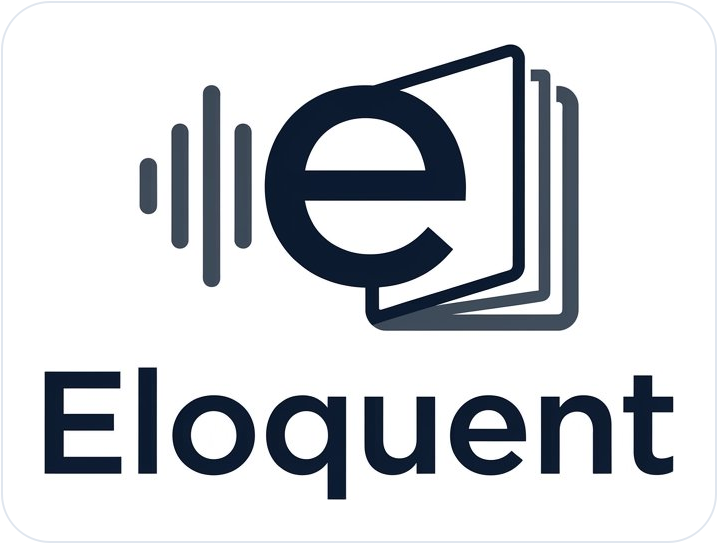

<p align="center">
  
</p>

# Eloquent

[](LICENSE)
[]()
[]()
[-76b900.svg)]()
[](https://axbuilt.net)

**Open-source live speech-to-text for Windows that runs fast on an ordinary CPU.**
Built for **meetings, classes, lectures, interviews, calls, and voice notes**. Speech recognition runs **100% locally on your CPU** (no GPU required, audio never leaves your PC).
Optionally, a free **Gemini 3.1 Flash-Lite** API key polishes the transcript in the background and generates **Meeting Minutes, Lecture Notes, Summaries, Bullet Points, or Reports** at the end of a session.

<!-- Add your 20s demo GIF or video here:

-->

---

## Highlights

- **Fast on CPU, zero recognition lag:** Powered by NVIDIA **Parakeet TDT 0.6B v3 (INT8)** and **Silero VAD** via `sherpa-onnx`. Supports 25 European languages automatically.
- **Multi-speaker diarization:** Identifies **Speaker 1, Speaker 2, …** on a low-priority background thread (`3D-Speaker CAM++`) with zero impact on live speech latency, including mid-turn speaker handoffs using Parakeet word timestamps.
- **Background LLM proofreading:** Every few sentences, Gemini 3.1 Flash-Lite fixes misheard words, punctuation, and spoken fillers in a background thread without slowing down live captions. If offline or if the model rewrites too much, raw text is kept automatically.
- **3 Interfaces, 1 Engine:**
  - **Floating Widget (`Eloquent.bat`, default):** Always-on-top compact pill with live audio meter, live captions, expandable transcript drawer (`⤢`), and global hotkeys.
  - **Terminal (`Eloquent-Terminal.bat`):** Clean Rich TUI where polished paragraphs scroll up and live speech stays at the bottom.
  - **Browser (`--ui web`):** Local page streamed via Server-Sent Events (SSE).
- **One-Click Post-Session Outputs (`Generate ▾`):** Turn any recorded session into:
  - **Concise Summary** (`summary.md`)
  - **Key Bullet Points** (`bullet_points.md`)
  - **Meeting Minutes & Action Items** (`meeting_minutes.md`)
  - **Lecture / Study Notes** (`lecture_notes.md`)
  - **Structured Report** (`report.md`)
  - **Clean Article / Memo** (`memo.md`)
  - **Custom Prompt…** (`custom_output.md`)

---

## Quick Start (Windows)

Requirements: **Windows 10/11** and **Python 3.10+** ([download](https://www.python.org/downloads/), tick *"Add python.exe to PATH"*). No GPU needed.

```bat
git clone https://github.com/EllouziMedAmin/Eloquent.git
cd Eloquent
setup.bat
```

That's the whole install. When `setup.bat` finishes you can:
- Press **`Ctrl+Shift+E`** anywhere in Windows to start Eloquent, or
- double-click the **Eloquent** icon on your Desktop / Start Menu.

What `setup.bat` does:
1. Creates `.venv` and installs the dependencies (`requirements.txt`).
2. Creates the **Eloquent** Desktop and Start Menu shortcuts.
3. Starts a tiny background launcher (a few MB, no window) that listens for `Ctrl+Shift+E`, and adds it to Windows startup so the hotkey keeps working after a reboot.
4. Copies `.env.example` to `.env` (optional Gemini key, see below).

On the **first launch** Eloquent downloads the speech model (~670 MB, once) into `models/`.

**Change the launch hotkey:** edit `launch_hotkey` in `%APPDATA%\Eloquent\settings.json` (e.g. `"ctrl+shift+q"`), then sign out and in, or run `.venv\Scripts\python.exe -m eloquent --create-shortcut` again. If another app already uses the key, the reason is written to `%APPDATA%\Eloquent\hotkey.log`.

**Uninstall:** delete the Eloquent shortcuts (Desktop, Start Menu, and `Start Menu\Programs\Startup\Eloquent Hotkey.lnk`), end `pythonw.exe` in Task Manager if it's running, then delete the repo folder.

Or install as a standard Python package:
```bat
pip install -e .
eloquent
```

### Optional: Free Gemini API Key (for live polishing & summaries)
1. Grab a free key from [Google AI Studio](https://aistudio.google.com/apikey).
2. Paste it in the widget (**`⋯` → `Settings`**), or copy `.env.example` to `.env` and set `GEMINI_API_KEY=your_key`.
3. Without a key, Eloquent runs 100% offline with raw Parakeet transcription.

---

## Controls & Shortcuts

### Widget Mode (`Eloquent.bat` or `Ctrl+Shift+E`)
- **`Ctrl+Shift+E`** — Launch Eloquent from anywhere in Windows (handled by the tiny background launcher `setup.bat` installs); if it's already open, it comes to the front.
- **`▶` / `■`** (or **`Ctrl+Shift+Space`**, customizable to e.g. **`Ctrl+Up`** in Settings) — Start / Stop recording.
- **`⤢`** (or double-click the pill) — Expand / collapse the full transcript & report drawer.
- **`Generate ▾`** — Generate Summary, Bullet Points, Meeting Minutes, Lecture Notes, Report, Memo, or Custom Prompt.
- **`⋯`** — Settings, *Save audio recording* toggle (`audio.wav`), *Always on top*, *Create shortcuts + launch hotkey*, *Minimize*.
- **`✕`** — Quit Eloquent cleanly (finishes any sentence in progress first).

### Terminal Mode (`Eloquent-Terminal.bat`)
- **`Space`** — Start / Stop recording
- **`G`** — Generate formatted output (`[1]–[6]`)
- **`Q`** or **`Ctrl+C`** — Stop and quit

### CLI Options
```bat
python -m eloquent --ui widget                     # floating widget (default)
python -m eloquent --ui terminal --save-audio      # terminal UI + save audio.wav
python -m eloquent --ui web                        # browser UI at http://127.0.0.1:8765
python -m eloquent --input lecture.wav --format lecture   # transcribe WAV & generate lecture_notes.md
python -m eloquent --no-clean                      # raw ASR only, no LLM
python -m eloquent --no-diarize                    # disable multi-speaker identification
python -m eloquent --list-devices                  # list microphone indices
```

All sessions are saved to `sessions/<YYYY-MM-DD_HH-MM-SS>/` with `raw.txt`, `clean.txt`, optional `audio.wav`, and any generated `.md` files.

---

## Roadmap

- [x] Shared low-latency engine + Widget, Terminal, and SSE Web UIs
- [x] Post-session generation (Summary, Bullets, Meeting Minutes, Lecture Notes, Report, Memo, Custom Prompt)
- [x] Multi-speaker diarization (`Speaker 1`, `Speaker 2`, …)
- [ ] Local LLM backend (Ollama / LM Studio / `llama.cpp` OpenAI-compatible endpoints)
- [ ] Standalone Windows installer (`.exe`)

---

## License & Credits

- **Built by:** [axbuilt.net](https://axbuilt.net) · [GitHub](https://github.com/EllouziMedAmin/Eloquent)
- **Code:** [MIT License](LICENSE)
- **ASR Model:** [NVIDIA Parakeet TDT 0.6B v3](https://huggingface.co/nvidia/parakeet-tdt-0.6b-v3) (CC-BY-4.0), INT8 ONNX export via [sherpa-onnx](https://github.com/k2-fsa/sherpa-onnx)
- **VAD:** [Silero VAD](https://github.com/snakers4/silero-vad)

> Independent open-source project; not affiliated with Google or NVIDIA.
