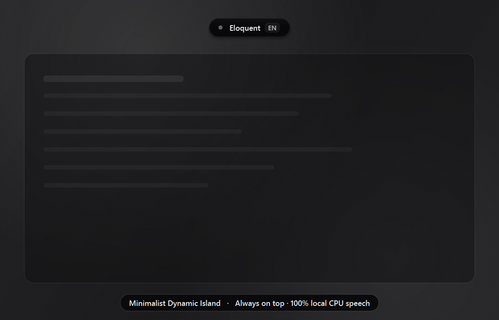

<p align="center">
  
</p>

# Eloquent

[](LICENSE)
[]()
[]()
[-76b900.svg)]()
[-ff6f00.svg)]()
[](https://axbuilt.net)

**Open-source live speech-to-text, voice dictation, and AI writing assistant for Windows that runs fast on an ordinary CPU.**

Built for **voice dictation into any app, Ask AI writing at your cursor, meetings, classes, lectures, interviews, calls, and voice notes**, wrapped in a minimalist **Apple Dynamic Island** floating widget. Speech recognition and speaker diarization run **100% locally on your PC** (audio never leaves your device), with **NVIDIA Parakeet TDT 0.6B v3** as the default (**25 European languages** on CPU) plus built-in **Arabic & Dialects** support (**Cohere Arabic Q4_K_M GGUF** on Vulkan iGPU / CPU, switchable anytime with **`Ctrl+Alt+M`**).

Optionally, a free **Google AI Studio (Gemini API)** key powers smart Free-Tier routing (`Auto` across Gemini 3.5/3.6 Flash, Flash-Lite, and Gemma 4 with automatic rate-limit fallback) to polish transcripts in the background, power **Dictate** / **Ask AI at cursor**, and generate **Meeting Minutes, Lecture Notes (with LaTeX math), Summaries, Bullet Points, or Reports** at the end of a session.

<!-- Add your 20s demo GIF or video here:

-->

---

## Highlights

### Minimalist Dynamic Island UI
- **Always-on-top monochrome obsidian pill:** Docks cleanly at top-center with magnetic snap, blooms controls on hover, morphs smoothly when recording, and never steals foreground focus from the app you are typing in.
- **Steady selectable sizes (`Small`, `Medium`, `Large`):** Choose your preferred fixed width from `⋯ → Island size` or Settings so the pill stays rock-steady while you speak (no resizing mid-sentence).
- **Expandable transcript & report drawer:** Single-click the pill (or `⤢`) to open a resizable obsidian transcript card with live speaker badges, `overlap` indicators, Markdown + LaTeX math report rendering, and a unified 3-tab monochrome Settings window (`Audio & Speech`, `AI & Polishing`, `Shortcuts`).

### 100% Local Speech Engines
- **Parakeet TDT 0.6B v3 INT8 (Default, CPU):** Fast on ordinary CPUs via `sherpa-onnx` + Silero VAD, covering **25 European languages** automatically with word-level timestamps.
- **Arabic & Dialects (`Ctrl+Alt+M`, Vulkan iGPU / CPU):** Hot-swap anytime to **Cohere Transcribe Arabic (`Q4_K_M` GGUF)** via `transcribe.cpp`, with automatic right-to-left (RTL) captions, transcripts, and reports plus dialect-aware Gemini proofreading across Modern Standard Arabic (الفصحى), Maghrebi/Darija, Egyptian, Levantine, and Gulf speech (including mixed French/English technical terms).

### System-Wide Voice Dictation & Ask AI at Cursor
- **Voice Dictation (`Ctrl+Alt+Space`):** Place your cursor in any text box (ChatGPT, VS Code, Cursor, Slack, WhatsApp, email, browser), press `Ctrl+Alt+Space` to speak, and press again to clean up hesitations/self-corrections and paste directly at your cursor while restoring your previous clipboard.
- **Ask AI / Compose at Cursor (`Ctrl+Alt+A`):** Speak an instruction (e.g. *"write an email to Sarah pushing tomorrow's meeting to Thursday"*, *"translate this to French"*, *"reply to this message"*) to generate and paste finished text straight at your cursor. Automatically reads highlighted text on screen for context and remembers recent turns for follow-ups (like *"now generate a subject"*).

### Overlap-Aware Multi-Speaker Diarization & Personal Dictionary
- **TitaNet-Small + `pyannote-segmentation-3.0`:** Identifies **Speaker 1, Speaker 2, …** on 1 low-priority background thread with zero impact on live speech latency (works in both **Parakeet** and **Arabic** modes). Strips overlapping speech frames before extracting voiceprints so cross-talk doesn't corrupt speaker clusters, and marks cross-talk turns with **`overlap`** badges (`[overlap]` in saved files).
- **Interactive live speaker editing:** Click any speaker badge in the transcript drawer to **Change a single line**, **Rename**, **Merge all into another speaker**, **Reassign overlap turns**, or **Undo / Reset**. Use **`⋯ → Max speakers`** (`Auto` or `2–8`) live during noisy calls or debates.
- **Personal Dictionary & Right-Click "Correct & Remember":** Store custom names/brands and `misheard -> corrected` rules (`⋯ → Personal dictionary…`), or right-click any misheard word in the transcript to fix it immediately and remember it for future sessions (correction rules work offline too).

### Background Polishing, Post-Session Reports & 3 Interfaces
- **Smart Free-Tier LLM routing & fallback:** In `Auto` mode (default), Eloquent automatically picks fast Free-Tier models per task (Gemini 3.5 Flash-Lite for live polishing, Gemma 4 26B for dictation, Gemini 3.6 Flash for Ask AI & reports) and fails over automatically on `429` rate limits or `503`/`504` timeouts. If offline or if an edit diverges too far, raw text is kept automatically.
- **One-Click Post-Session Outputs (`Generate ▾`):** Turn any recorded session into:
  - **Concise Summary** (`summary.md`)
  - **Key Bullet Points** (`bullet_points.md`)
  - **Meeting Minutes & Action Items** (`meeting_minutes.md`)
  - **Lecture / Study Notes** (`lecture_notes.md`, with native LaTeX math rendering)
  - **Structured Report** (`report.md`)
  - **Clean Article / Memo** (`memo.md`)
  - **Custom Prompt…** (`custom_output.md`)
- **3 Interfaces, 1 Shared Engine:**
  - **Dynamic Island Widget (`Eloquent.bat`, default):** Floating pill, transcript drawer, tray icon, and global hotkeys.
  - **Terminal (`Eloquent-Terminal.bat`):** Rich TUI where polished paragraphs scroll up and live speech stays pinned at the bottom.
  - **Browser (`--ui web`):** Local web UI streamed via Server-Sent Events (SSE) at `http://127.0.0.1:8765`.

---

## Quick Start (Windows)

Requirements: **Windows 10/11** and **Python 3.10+** ([download](https://www.python.org/downloads/), tick *"Add python.exe to PATH"*). No dedicated GPU needed.

```bat
git clone https://github.com/EllouziMedAmin/Eloquent.git
cd Eloquent
setup.bat
```

Once `setup.bat` finishes, you can:
- Press **`Ctrl+Shift+E`** from anywhere in Windows to launch or focus Eloquent, or
- Double-click the **Eloquent** icon on your Desktop or Start Menu.

What `setup.bat` does:
1. Creates `.venv` and installs dependencies from `requirements.txt`.
2. Creates Desktop and Start Menu shortcuts for Eloquent.
3. Starts a tiny background launcher (a few MB, no window) that listens for `Ctrl+Shift+E` and registers it in Windows Startup so the hotkey keeps working after a reboot.
4. Copies `.env.example` to `.env` (for an optional Gemini API key).

### Automatic First-Run Model Downloads
All models download automatically on demand into `models/`:

| Model | Purpose | Approx. Size | When Downloaded |
| :--- | :--- | :--- | :--- |
| **Parakeet TDT 0.6B v3 INT8 + Silero VAD** | Default ASR (25 European languages, CPU) | ~640 MB | First launch |
| **NeMo TitaNet-Small + `pyannote-segmentation-3.0`** | Speaker identification & overlap detection | ~44 MB | First launch (when diarization is on) |
| **Cohere Arabic Q4_K_M GGUF + `transcribe.cpp`** | Arabic & Dialects ASR (Vulkan iGPU / CPU) | ~1.5 GB | First switch to Arabic (`Ctrl+Alt+M`) |

### Optional: Free Gemini API Key (Polishing, Ask AI & Reports)
1. Grab a free key from [Google AI Studio](https://aistudio.google.com/apikey).
2. Paste it in the widget (**`⋯` → `Settings` → `AI & Polishing`**), or copy `.env.example` to `.env` and set `GEMINI_API_KEY=your_key`.
3. Without a key, Eloquent runs **100% offline** with raw Parakeet or Cohere Arabic transcription, local diarization, and offline dictionary correction rules.

### Alternative Install & Uninstall
- **Standard Python package:** `pip install -e .` then run `eloquent`.
- **Change the launch hotkey:** Edit `launch_hotkey` in `%APPDATA%\Eloquent\settings.json` (e.g. `"ctrl+shift+q"`), then re-run `.venv\Scripts\python.exe -m eloquent --create-shortcut` (or sign out and back in). Any hotkey conflict is logged to `%APPDATA%\Eloquent\hotkey.log`.
- **Uninstall:** Delete the Eloquent shortcuts (Desktop, Start Menu, and `Start Menu\Programs\Startup\Eloquent Hotkey.lnk`), close `pythonw.exe` in Task Manager if running, and delete the repo folder.

---

## Controls & Shortcuts

### Global Hotkeys (All Customizable in `Settings → Shortcuts`)

| Shortcut | Action |
| :--- | :--- |
| **`Ctrl+Shift+E`** | Launch or bring Eloquent to the front from anywhere in Windows |
| **`Ctrl+Shift+Space`** | Start / Stop recording notes or meetings (`▶` / `■`) |
| **`Ctrl+Alt+Space`** | **Dictate at cursor:** press once in any app to talk, press again to clean & paste |
| **`Ctrl+Alt+A`** | **Ask AI at cursor:** speak an instruction (optionally with text highlighted) to generate & paste |
| **`Ctrl+Alt+M`** | Toggle live between **Parakeet (25 European languages)** and **Arabic & Dialects** |

### Dynamic Island Gestures & Menus
- **Hover the idle pill:** Reveals `▶` (Record), `⤢` (Expand), `⋯` (Menu), and `✕` (Quit).
- **Single-click the pill (or `⤢`):** Expands / collapses the resizable transcript & report drawer.
- **Drag the pill:** Move anywhere on screen; drag near top-center for a magnetic snap back home (or use **`⋯ → Reset island position`**).
- **`Generate ▾`:** Generate Summary, Bullet Points, Meeting Minutes, Lecture Notes, Report, Memo, Custom Prompt, or bulk **Rename speakers…**.
- **`⋯` menu:** *Settings…*, *Personal dictionary…*, *Switch speech model*, *Audio source*, *Max speakers*, *Save audio recording*, *Island size (`Small` / `Medium` / `Large`)*, *Always on top*, *Open sessions folder*, *Clear Ask AI memory*, *Create shortcuts + launch hotkey*, *Reset island position*, *Minimize*, *Quit*.

### Live Speaker Controls & Word Corrections (Inside the Transcript Drawer)

#### 1-Click Speaker Menu (click any speaker badge, e.g. `Speaker 1`)
- **`Change this line to`:** Reassign only that single line to another speaker without affecting other turns.
- **`Rename "…"…`:** Name a speaker (updates every turn and saved files immediately), or use **`Generate ▾ → Rename speakers…`** to rename everyone at once.
- **`Merge all "…" into`:** Combine duplicate clusters of the same person into one speaker; Eloquent keeps their voice anchors so later turns stay merged.
- **`Reassign all overlap turns`:** Dissolve a cross-talk/overlap-only speaker cluster and reassign its turns to the closest real speakers.
- **`Undo last speaker change` / `Reset speaker edits`:** Revert speaker edits anytime in one click.

#### Right-Click Word Correction & Personal Dictionary
- **Correct & Remember from the transcript:** Highlight any misheard word or short phrase in the transcript, right-click it, and choose **`Correct "…"…`**. Eloquent fixes every matching occurrence in the current transcript immediately and saves the rule to your Personal Dictionary for future sessions.
- **Personal Dictionary (`⋯ → Personal dictionary…` or `Settings → AI & Polishing`):**
  - **Names & Terms** (your name, brands, jargon such as `Axbuilt`, `Kubernetes`): injected into AI polishing only when spoken text sounds similar, keeping normal sentences untouched.
  - **Word Corrections (`Misheard → Corrected`)** (e.g. `axe built → Axbuilt`, `normal mo → normalement`): recurring ASR mistake mappings that work **both with AI polishing and 100% offline**.

### Terminal Mode (`Eloquent-Terminal.bat`)
- **`Space`** — Start / Stop recording
- **`G`** — Generate formatted document (`[1]–[6]`)
- **`Q`** or **`Ctrl+C`** — Finish current sentence and quit

---

## Tips & Best Practices

### 1. Choosing the Right Audio Source (`⋯ → Audio source`)

| Audio Source | Best For | How It Works |
| :--- | :--- | :--- |
| **`Microphone`** | Dictation (`Ctrl+Alt+Space`), Ask AI (`Ctrl+Alt+A`), voice notes, in-person rooms | Captures your microphone only. (Note: Dictation and Ask AI always use your microphone regardless of this setting.) |
| **`System audio`** | YouTube videos, podcasts, recorded lectures, webinars, listening-only calls | Captures Windows WASAPI playback directly with **zero room echo** and the cleanest possible multi-speaker separation. |
| **`Mic + System`** | Live calls & meetings (Zoom, Teams, Meet, Discord) where **both you and remote people speak** | Labels your microphone automatically as **`You`** and separates remote speakers from system playback as `Speaker 1, Speaker 2, …`. |

> [!IMPORTANT]
> **Always wear headphones or earbuds when using `Mic + System`.**
> If remote audio plays out of your laptop/desk speakers while your mic is active, the remote voices will bleed into your microphone, causing duplicate lines (labeled as `You`) and weaker speaker separation. With headphones, both streams stay completely clean.

> [!TIP]
> **Transcribing a video, podcast, or lecture on your PC?** Switch to **`System audio`** instead of recording speakers through your microphone. Direct WASAPI loopback eliminates room reverb and dramatically improves both transcription accuracy and speaker diarization.

### 2. Getting the Cleanest Multi-Speaker Diarization
- **Use `Max speakers` when you know the headcount:** For a 2-person interview or 3-person panel in a noisy/echoey room, set **`⋯ → Max speakers`** to `2` or `3`. It applies live without restarting the recording and prevents extra phantom speakers.
- **Fix speakers on the fly:** Click any speaker badge in the expanded transcript drawer to rename (`Speaker 1` → `Sarah`), merge two clusters of the same person, or move a single misattributed line. Eloquent locks your manual anchors so later turns stay consistent.
- **Understand `overlap` badges:** When two people talk over each other simultaneously, `pyannote-segmentation-3.0` strips the overlapping frames before voiceprinting so clusters stay pure, and flags that turn with an **`overlap`** badge (`[overlap]` in saved text files) so you know cross-talk occurred there.

### 3. Arabic & Bilingual (AR + FR/EN) Tips
- **Instant toggle:** Press **`Ctrl+Alt+M`** while idle to flip between Parakeet and Cohere Arabic without changing your startup default (`Settings → Audio & Speech → Default speech model`).
- **Teach your recurring terms:** Add your name, company/product names, or frequent French/English words spoken inside Arabic sentences (e.g. `normal mo -> normalement`) via **`⋯ → Personal dictionary…`** or by right-clicking a word in the transcript.
- **Automatic Vulkan acceleration:** On Intel Iris Xe, AMD, or NVIDIA GPUs with Vulkan drivers, Cohere Arabic automatically accelerates on the GPU and falls back to CPU seamlessly if unavailable.

### 4. Voice Dictation & Ask AI Power Tips
- **Edit or reply to existing text in place:** Highlight text in any app first, press **`Ctrl+Alt+A`**, and say *"make this more polite"*, *"fix grammar"*, *"translate to French"*, or *"write a short reply saying I'm free at 3pm"*.
- **Use follow-up memory:** Ask AI remembers recent turns within the current run — generate an email body, click the Subject field, press **`Ctrl+Alt+A`**, and say *"write a short subject for that email"*. Reset context anytime with **`⋯ → Clear Ask AI memory`**.
- **Cancel without pasting:** If you start dictating or Ask AI and decide not to paste, click **`■`** on the Island instead of pressing the hotkey again. Nothing is pasted into your app, and your captured text stays saved in the expanded drawer (`⤢`).
- **Keep your clipboard intact:** *Restore previous clipboard after pasting* is enabled by default in `Settings → Shortcuts`, so dictating won't wipe whatever you copied earlier.

---

## CLI Options & Session Files

```bat
python -m eloquent --ui widget                                # Dynamic Island widget (default)
python -m eloquent --speech-lang arabic                       # start in Arabic mode (Cohere Q4_K_M GGUF, RTL UI)
python -m eloquent --source system                            # capture Windows speaker playback directly
python -m eloquent --source both                              # capture mic (You) + system audio (use headphones)
python -m eloquent --ui terminal --save-audio                 # terminal TUI + save audio.wav
python -m eloquent --ui web                                   # browser UI at http://127.0.0.1:8765
python -m eloquent --input lecture.wav --format lecture       # transcribe WAV & generate lecture_notes.md
python -m eloquent --input call.wav --prompt "List decisions" # transcribe WAV with a custom prompt
python -m eloquent --no-clean                                 # raw local ASR only, no LLM
python -m eloquent --no-diarize                               # disable multi-speaker identification
python -m eloquent --list-devices                             # list microphones & Windows loopback devices
python -m eloquent --settings-path                            # print settings.json path
```

Every meeting/note session is saved to `sessions/<YYYY-MM-DD_HH-MM-SS>/` containing:
- `raw.txt` — timestamped raw local transcript (with speaker labels and `[overlap]` markers when diarization is on)
- `clean.txt` — LLM-polished transcript (when polishing is enabled)
- `audio.wav` — optional 16 kHz recording (when *Save audio recording* is enabled)
- `*.md` — any generated reports (`summary.md`, `meeting_minutes.md`, `lecture_notes.md`, etc.)

---

## Roadmap

- [x] Shared low-latency engine + Widget, Terminal, and SSE Web UIs
- [x] Post-session document generation (Summary, Bullets, Meeting Minutes, Lecture Notes + LaTeX math, Report, Memo, Custom Prompt)
- [x] Overlap-aware multi-speaker diarization (`TitaNet-Small` + `pyannote-segmentation-3.0`) with live speaker rename, merge, line reassignment & `Max speakers` cap
- [x] System-wide Voice Dictation (`Ctrl+Alt+Space`) and Ask AI / Compose at Cursor (`Ctrl+Alt+A`) with screen selection context & follow-up memory
- [x] Windows WASAPI system audio loopback (`Microphone`, `System audio`, `Mic + System`)
- [x] Local Arabic & dialects speech engine (`Cohere Transcribe Arabic Q4_K_M GGUF` on Vulkan / CPU) + RTL UI
- [x] Personal Dictionary & right-click "Correct & Remember" in transcript
- [x] Minimalist monochrome Apple Dynamic Island UI (`Small` / `Medium` / `Large`) & unified tabbed Settings
- [ ] Local LLM backend (Ollama / LM Studio / `llama.cpp` OpenAI-compatible endpoints)
- [ ] Standalone Windows installer (`.exe`)

---

## License & Credits

- **Built by:** [axbuilt.net](https://axbuilt.net) · [GitHub](https://github.com/EllouziMedAmin/Eloquent)
- **Code:** [MIT License](LICENSE)
- **Default ASR (25 European languages):** [NVIDIA Parakeet TDT 0.6B v3](https://huggingface.co/nvidia/parakeet-tdt-0.6b-v3) (CC-BY-4.0), INT8 ONNX export via [sherpa-onnx](https://github.com/k2-fsa/sherpa-onnx)
- **Arabic ASR:** [Cohere Transcribe Arabic (Q4_K_M GGUF)](https://huggingface.co/handy-computer/cohere-transcribe-arabic-07-2026-gguf) via [transcribe.cpp](https://github.com/handy-computer/transcribe.cpp) (CPU + Vulkan GPU)
- **Speaker Embeddings:** [NVIDIA NeMo TitaNet-Small](https://huggingface.co/nvidia/speakerverification_en_titanet_small) via [sherpa-onnx](https://github.com/k2-fsa/sherpa-onnx)
- **Overlap & Speaker Segmentation:** [pyannote-segmentation-3.0](https://huggingface.co/pyannote/speaker-segmentation-3.0) (ONNX via [sherpa-onnx](https://github.com/k2-fsa/sherpa-onnx))
- **VAD:** [Silero VAD](https://github.com/snakers4/silero-vad)

> Independent open-source project; not affiliated with Google, NVIDIA, Apple, or Cohere.
